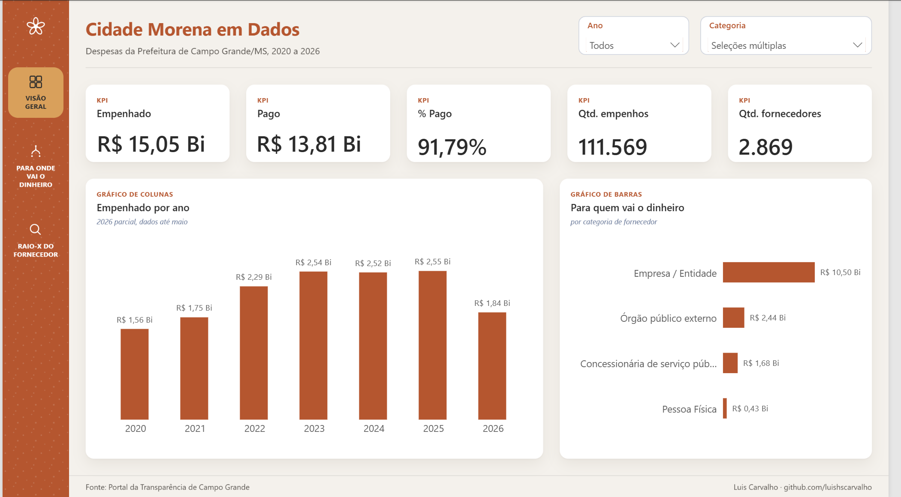
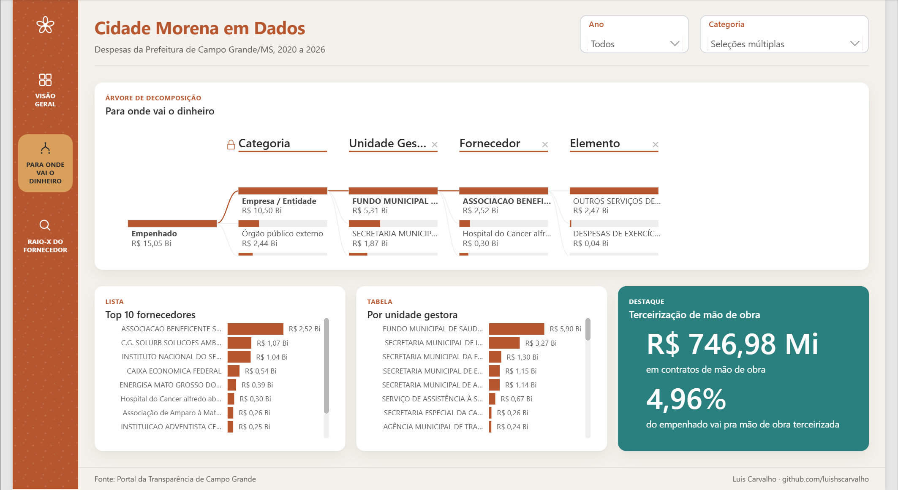
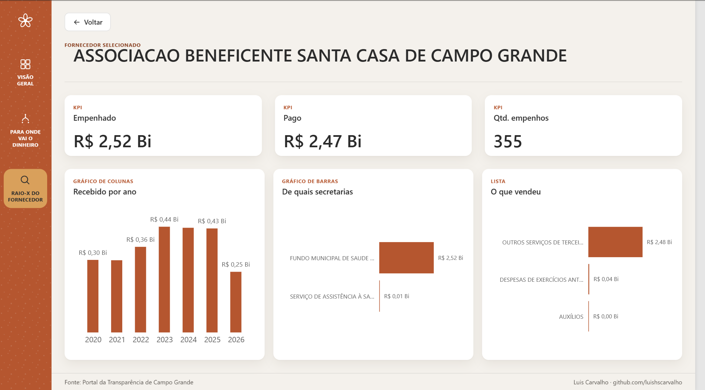
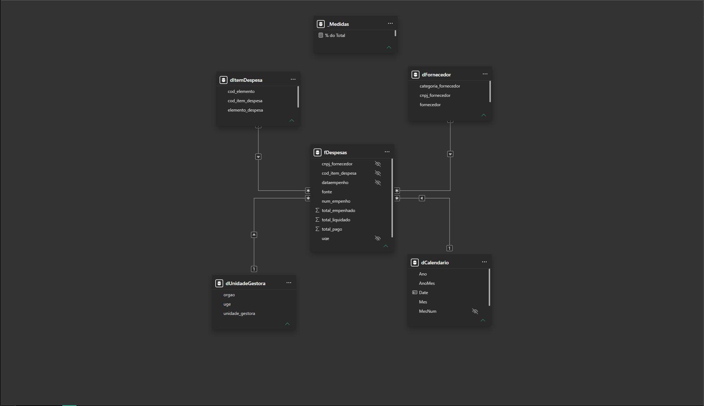

# Cidade Morena em Dados

**Para onde vai o dinheiro da Prefeitura de Campo Grande/MS?**

Dashboard em Power BI com **7 anos de despesas públicas (2020 a mai/2026)**: 121.425 empenhos e **R$ 36,8 bilhões** empenhados, tratados a partir dos dados abertos oficiais da prefeitura.

---

## O dashboard

**1. Visão Geral:** quanto a prefeitura empenha, quanto paga e para quem. As segmentações abrem **sem** os repasses intragovernamentais (a prefeitura pagando a si mesma), e o usuário pode incluí-los.



**2. Para onde vai o dinheiro:** árvore de decomposição (categoria > unidade gestora > fornecedor > elemento), ranking de fornecedores, gasto por unidade gestora e o peso da terceirização de mão de obra.



**3. Raio-x do fornecedor:** página de *drill-through*. Botão direito em qualquer fornecedor > *Detalhar* abre a ficha dele: quanto recebeu por ano, de quais secretarias e o que vendeu.



**Design:** layout feito como imagem de fundo (1280x720) com os visuais nativos posicionados por cima, e tema próprio ([`dados/suporte/tema_cidade_morena.json`](dados/suporte/tema_cidade_morena.json)). A cor principal é terracota, a cor da terra roxa que deu a Campo Grande o apelido de Cidade Morena.

---

## Principais achados

- **59% do dinheiro não sai da máquina pública.** R$ 21,8 bi dos R$ 36,8 bi empenhados vão para a própria prefeitura, fundos e institutos municipais: folha empenhada em nome do município, contribuição ao instituto de previdência, repasses ao fundo de saúde. O dashboard deixa o usuário escolher se quer ver esses valores.
- **Folha centralizada.** A Secretaria de Administração (SEMADI) concentra 32% do empenhado, mas 74% disso são vencimentos e 17% obrigações patronais: é por ela que passa a folha de pagamento.
- **Saúde domina entre os fornecedores externos.** Excluindo os repasses internos, 4 dos 5 maiores recebedores são da saúde. A Santa Casa lidera com R$ 2,5 bi.
- **Metade do que vai para empresas passa por um único fundo.** Dos R$ 10,5 bi pagos a empresas e entidades, R$ 5,3 bi saem do Fundo Municipal de Saúde, e quase metade disso (R$ 2,5 bi) vai para a Santa Casa, em "outros serviços de terceiros".
- **Terceirização de mão de obra:** R$ 747 mi em contratos de mão de obra (elemento 3.3.90.37), 5% do que sai da máquina pública.
- **Crescimento anual:** +14,9% (2021), +15,8% (2022), +2,9% (2023), +12,1% (2024), +2,7% (2025).
- **Execução cai no ano corrente:** ~100% do empenhado foi pago em 2020 a 2023, contra 38% em 2026. Esperado: a prefeitura empenha o ano inteiro de contratos no início do exercício e paga mês a mês.

## Problemas encontrados nos dados (e como foram tratados)

| Problema | Impacto se ignorado | Tratamento |
|---|---|---|
| Valores com ponto decimal (padrão en-US) | A localidade pt-BR lia `570.06` como `57006`: totais inflados em 100x | Conversão de tipo com localidade `en-US` |
| Detecção automática de tipos | CNPJ e códigos viravam número, perdendo zeros à esquerda; valores corrompidos | Tipos definidos manualmente, identificadores como texto |
| Layout dos arquivos muda em 2025 (nomes de coluna, formato de data, aspas) | O "Combinar arquivos" **descartava em silêncio** colunas de 2025-2026 (27% vazio) | Renomeação dentro da função de combinação com `MissingField.Ignore` |
| CPF de pessoa física no campo de CNPJ | Exposição de dados pessoais | Anonimização no ETL (LGPD): nome e documento substituídos por "PESSOA FÍSICA" |
| Mesma chave com nomes diferentes ao longo dos anos (secretarias renomeadas, grafias de fornecedores) | Relacionamento muitos-para-muitos | Dimensões com o nome **mais recente** de cada chave |
| Arquivo estranho na pasta de origem | Linhas lixo no modelo | Filtro para aceitar só `.csv` |
| **Data de empenho muda de comportamento a partir de 2025** (ver abaixo) | Comparações mensais falsas | Comparações só entre anos completos |

### A data que mudou de significado

De 2020 a 2024, o grosso do ano (R$ 2 a 3,5 bi em empenhos globais de folha) aparece em **janeiro**. Em 2025, janeiro tem só R$ 13 mi e **dezembro concentra R$ 4,3 bi**, com 5x mais empenhos que o normal e números de empenho baixos, típicos do começo do ano. Em 2026, o grosso cai em abril e maio.

Hipótese: a partir do layout novo, a data publicada nem sempre é a data de emissão do empenho. **Os totais anuais continuam confiáveis** (reconciliados com os arquivos de origem), mas uma comparação "jan-mai/2026 contra jan-mai/2025" daria **+1.131%**. Por isso o dashboard compara apenas anos completos e marca 2026 como parcial.

## Arquitetura

```
CSVs anuais (Portal da Transparência)
        │  Obter de Pasta + parâmetro de caminho
        ▼
stgDespesas  (staging: tipos, localidade, padronização, LGPD)
        │
        ├──► fDespesas         fato: 1 linha = 1 empenho
        ├──► dUnidadeGestora   41 unidades
        ├──► dFornecedor       2.884 fornecedores + categoria (de-para)
        └──► dItemDespesa      307 itens / elementos de despesa
                                + dCalendario (DAX)
```

**Modelo estrela:** fato no centro, 4 dimensões, relacionamentos 1:N com filtro em direção única.



### Categorias de fornecedor

Classificação via tabela de-para ([`dados/suporte/categoria_fornecedor.csv`](dados/suporte/categoria_fornecedor.csv)), editável sem abrir o Power Query:

| Categoria | Exemplos | Empenhado (2020-2026) |
|---|---|---|
| Intragovernamental (Prefeitura de CG) | Município de CG, IMPCG, Fundo Municipal de Saúde | R$ 21,8 bi |
| Empresa / Entidade | Santa Casa, hospitais, construtoras | R$ 10,5 bi |
| Órgão público externo | INSS, Caixa, tribunais, ministérios | R$ 2,4 bi |
| Concessionária de serviço público | Solurb, Energisa, Águas Guariroba, Consórcio Guaicurus | R$ 1,7 bi |
| Pessoa física (anonimizada) | | R$ 0,4 bi |

## Medidas DAX

Organizadas em pastas na tabela `_Medidas`. Código completo em [`dax/medidas.dax`](dax/medidas.dax).

| Pasta | Medidas |
|---|---|
| Base | Empenhado, Liquidado, Pago, Qtd Empenhos, Qtd Fornecedores, Ticket Médio |
| Execução | % Liquidado, % Pago |
| Participação | % do Total |
| Tempo | Empenhado Acumulado, Empenhado Ano Anterior, Var % Ano Anterior |
| Ranking | Ranking Fornecedor |
| Terceirização | Empenhado Mão de Obra, % Mão de Obra (elemento 3.3.90.37) |

## Validação

Uma página oculta do relatório reconcilia os totais com os arquivos de origem, imune às segmentações:

| Ano | Empenhado |
|---|---|
| 2020 | R$ 3.965.565.387,79 |
| 2021 | R$ 4.557.637.898,04 |
| 2022 | R$ 5.277.671.051,70 |
| 2023 | R$ 5.431.521.781,88 |
| 2024 | R$ 6.090.041.345,32 |
| 2025 | R$ 6.255.843.836,36 |
| 2026 (até 15/05) | R$ 5.265.018.713,96 |
| **Total** | **R$ 36.843.300.015,05** |

## Como reproduzir

1. Baixe os CSVs de despesa de 2020 a 2026 no [Portal da Transparência de Campo Grande](https://transparencia.campogrande.ms.gov.br/canais/despesas-dados-abertos/) (*Dados Abertos > Despesa*) e salve em `dados/brutos/`.
2. Abra `pbix/cidade_morena_em_dados.pbix` no Power BI Desktop.
3. Em *Transformar dados > Gerenciar parâmetros*, aponte `CaminhoPasta` para a sua pasta `dados/brutos` e `CaminhoPastaSuporte` para `dados/suporte`.
4. *Atualizar*.

Os scripts M de cada consulta estão em [`powerquery/`](powerquery/), para leitura sem o Power BI.

## Stack

Power BI Desktop · Power Query (M) · DAX · modelagem dimensional

## Sobre

Projeto de portfólio de **Luis Henrique Souza Carvalho**, engenheiro de software (UFMS) com 4 anos desenvolvendo relatórios para o ERP público Betha (folha, contabilidade, compras, saúde, educação, tributos) em ~180 entidades municipais.

<!-- LinkedIn: adicionar link -->
